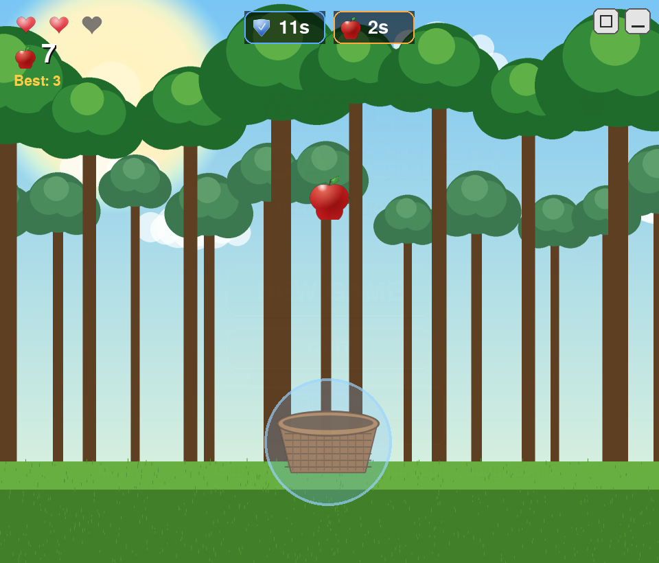
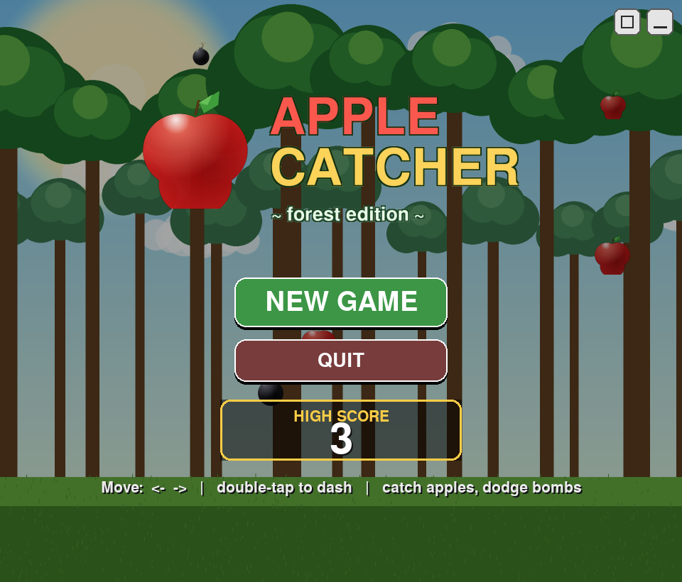
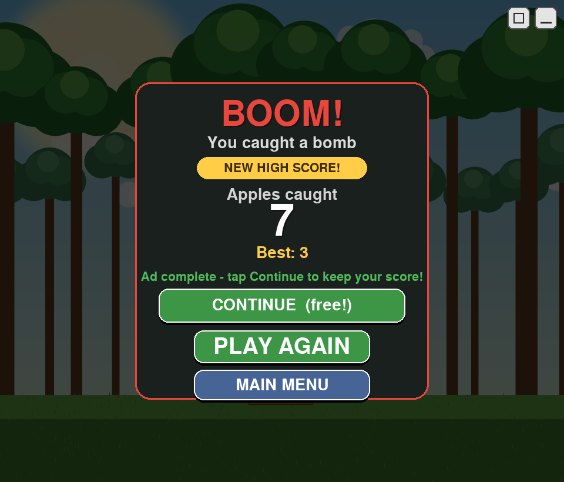

<div align="center">

# 🍎 Apple Catcher — Forest Edition

**A fast, juicy arcade catching game built with Python & pygame.**
Catch apples, dodge bombs, grab power-ups, and chase a new high score.




</div>

---

## ✨ Features

| | |
| --- | --- |
| 🍎 **Catch apples** | Slide your basket to catch apples falling through the forest. |
| 💣 **Dodge bombs** | Catch a bomb and it explodes — instant game over (with sound). |
| 🔄 **Shape-shifters** | Apples morph into bombs mid-fall… and bombs morph into apples. Watch closely. |
| 🌀 **Deceptive paths** | Many drops curve sideways on a sine-wave path to throw off your timing. |
| ❤️ **Three hearts** | Miss an apple and lose a heart. Lose all three and it's game over. |
| ⚡ **Dash boost** | Double-tap a direction to dash — the basket moves faster for 3 seconds. |
| 🛡️ **Shield power-up** | A rare drop that shields the basket from bombs for 15 seconds. |
| ↔️ **Basket extension** | A rare drop that widens the basket for 9 seconds. |
| ⏱️ **Live power-up timers** | Active shield / extension / dash timers are shown at the top of the screen. |
| 📺 **Watch-ad continue** | After a game over, watch a short ad to revive and keep your score. |
| 🏆 **Persistent high score** | Your best run is saved between sessions. |
| 🖥️ **Resizable & fullscreen** | Minimize / maximize buttons, drag-to-resize, and `F11` fullscreen. |
| 🎨 **High-res art & sound** | All artwork and sound effects are generated procedurally — no external assets to download. |

<div align="center">

&nbsp;&nbsp;

</div>

---

## 🎮 Controls

| Action | Keys / Input |
| --- | --- |
| Move basket | `←` / `→`  or  `A` / `D` |
| **Dash** (3s speed boost) | Double-tap `←←` or `→→` |
| Start game (menu) | **New Game** button or `Enter` |
| Play again (game over) | **Play Again** button or `R` |
| Continue after ad | **Continue** button or `C` (unlocks after 10s) |
| Back to menu | **Main Menu** button or `M` |
| Minimize window | `_` button (top-right) |
| Maximize / fullscreen | `▣` button (top-right) or `F11` |
| Back / quit | `Esc` |

---

## 🚀 Getting started

### 1. Requirements
- Python **3.8+**
- [pygame](https://www.pygame.org/) **2.5+**

A virtual environment with pygame is bundled in `.venv/`.

### 2. Install (if using your own environment)
```bash
pip install -r requirements.txt
```

### 3. Generate the art assets
The PNG assets ship with the repo, but you can regenerate them any time:
```bash
python tools/generate_assets.py
```

### 4. Play
```bash
python main.py
```
Or with the bundled environment:
```bash
.venv/bin/python main.py
```

> `python gameee.py` also still works — it's a thin launcher kept for
> backwards compatibility.

---

## 🗂️ Project structure

The game is organized as a small package rather than one big file, so each
concern lives on its own and is easy to find and extend:

```
Star-Catcher/
├── main.py                     # entry point  ->  python main.py
├── gameee.py                   # legacy launcher (kept for compatibility)
├── requirements.txt
├── apple_catcher/              # the game package
│   ├── __init__.py             # exposes Game
│   ├── settings.py             # all tunables: sizes, speeds, odds, colours
│   ├── assets.py               # image loading + scaled-surface cache + fonts
│   ├── audio.py                # procedurally synthesized sound effects
│   ├── storage.py              # high-score persistence
│   ├── entities.py             # FallingObject (apple/bomb/power-up) + Basket
│   ├── effects.py              # the bomb explosion animation
│   ├── ui.py                   # buttons, hearts, HUD, power-up timer bar
│   └── game.py                 # Game class: scenes, input, update, render
├── tools/
│   └── generate_assets.py      # renders all PNG art into assets/
├── assets/                     # generated artwork (apple, bomb, forest, ...)
└── docs/                       # screenshots used in this README
```

### Why a package instead of one file?
The original prototype was a single script with globals and one giant loop.
That's fine for a 50-line demo, but it gets hard to read and change as features
pile up. Splitting it into focused modules means:

- **`settings.py`** is the one place to balance difficulty or retheme colours.
- **`entities.py` / `effects.py`** hold self-contained objects you can test in
  isolation.
- **`game.py`** reads as high-level intent (scenes, events, update, render)
  instead of mixing rendering, physics, and I/O together.
- Assets and sound are decoupled, so swapping in new art or audio never touches
  game logic.

---

## 🎛️ Tuning the game

Open [`apple_catcher/settings.py`](apple_catcher/settings.py) and tweak:

```python
START_LIVES       = 3       # hearts
P_BOMB            = 0.16    # chance a drop starts as a bomb
P_SHIELD          = 0.05    # chance of a shield power-up
TRANSFORM_CHANCE  = 0.22    # chance an apple/bomb morphs mid-fall
SHIELD_TIME       = 15.0    # shield duration (seconds)
EXTEND_TIME       = 9.0     # basket-extension duration
BOOST_TIME        = 3.0     # dash duration
MAX_FALL_SPEED    = 830     # difficulty ceiling
```

To change the "watch ad" videos, edit `AD_URLS` in the same file.

---

## 🔧 How it works (under the hood)

- **No binary art or audio assets are shipped as hand-made files.** Every image
  (glossy apple, lit bomb, metallic shield, woven basket, layered forest, logo)
  is drawn with pygame using supersampling for clean, anti-aliased edges — see
  `tools/generate_assets.py`.
- **Sound effects are synthesized at runtime** into in-memory WAV buffers with
  the standard-library `wave` module (an explosion is a noise burst plus a low
  rumble with an exponential decay envelope). No numpy required.
- **Motion is delta-time based**, so gameplay speed is consistent regardless of
  frame rate.
- **The forest background is a single high-resolution image** scaled to the
  current window and cached, so resizing stays smooth.
- **The "watch ad" flow** opens the configured video in your default browser and
  unlocks the *Continue* button after 10 seconds — reviving the run with full
  hearts while keeping your score.

> **Audio note:** if your machine has no audio device, the game detects this and
> runs silently instead of crashing.

---

## 📜 License

Released under the **MIT License** — free to play, modify, and share.

<div align="center">

**Now go catch some apples — and whatever you do, don't catch the bomb. 💣**

</div>
